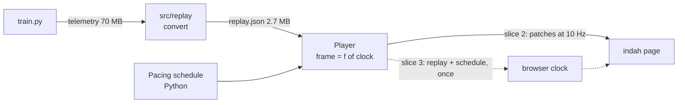

# Plan: browser dashboard for the Q-learning replay

Status: slices 1 to 4 done (the indah features are in review upstream, indah PR 272), slice 5 next. Supersedes the Pygame plan in `docs/archive/`.

## Goal

A single-screen (1920 x 1080, no scrolling) dashboard that replays a Q-learning run on Tower of
Hanoi from the first random episode to the first optimal 31-move solve, ready to screen-record for
YouTube. It shows the board, the explore/exploit decision, the full Q-table, and charts across and
within episodes, in dark and light themes (palette "Graphite and Citrus").

A second goal: find what [indah](https://github.com/leejianrong/indah) is missing for dashboards
like this and upstream it. Where indah falls short we say so here rather than work around it quietly.

## Decisions

| Decision | Why | ADR |
|----------|-----|-----|
| Build on indah in the browser, remove Pygame | Pygame crashed WSL; the layout outgrew hand-drawn UI | 0006 |
| Every frame is a pure function of one clock; the clock moves to the browser | Smooth 60 fps motion, scrubbing, deterministic video export | 0007 |
| Derive a compact columnar replay (2.7 MB) from telemetry (70 MB) | The Q-table is reproducible from the updates | 0008 |
| Board and pie live in this repo as indah bridge modules first, upstream later | Prove them before widening indah | 0006 |

### Server clock vs client clock

*Server clock:* Python decides what is on screen at every moment and sends each change over the
network. Simple, and every viewer is in sync, but motion is limited to a few updates a second,
every update crosses the network, and the video would depend on timing.

*Client clock:* the browser gets the whole replay once, then runs its own clock and draws each
frame itself. Python still decides the pacing (the timeline), the browser only follows it. Motion
is smooth, scrubbing is instant, and an exporter can advance the clock by hand, one frame at a
time. Slice 2 used the server clock to prove the layout; slice 3 replaced it with the browser clock.

## Shape

## Slices

| # | Slice | Status |
|---|-------|--------|
| 1 | Data layer: state ids, compact replay, Q-table rebuild, pacing schedule; Pygame removed | Done |
| 2 | Dashboard on today's indah with a server clock: layout, charts, heatmap, board and pie modules (no motion) | Done |
| 3 | Browser clock, board animation (lift, travel over, descend; no arrow), transport and scrubbing, pacing caps | Done |
| 4 | Indah features below (indah ADR-0044): fixed frame, scatter and bar charts, heatmap masks and highlights, pie | Done; built on indah branch `agent/dashboard-pie`, pinned in `pyproject.toml` until released |
| 5 | Deterministic clock, `?record` mode, frame capture and ffmpeg export | |
| 6 | Sound cues synced to the clock (ADR-0005), auto-pacing polish | |

## What indah lacks for this dashboard

Found while building slice 2; slice 4 upstreams the generic ones.

| Gap | State | Notes |
|-----|-------|--------|
| G1 Fixed viewport | Done: `Frame` (indah ADR-0044), `Grid` track lists, `Cell`, `height="fill"` | The whole dashboard fits one screen at any window size; `--kiosk` covers the window for recording |
| G2 Chart kinds | Done: `kind` (scatter, bars), playhead with the future dimmed, highlight bar, rules, ranges, `legend` | Used by all five charts |
| G3 Heatmap | Done: colour stops, blank cells (`null_color`), `origin`, row labels, column groups, `mark_x`/`mark_y` | Illegal moves are blank, the current state is spotlit with its action ringed |
| G4 Pie | Done as a generic `Pie` in indah, but this dashboard keeps its pie inside the stage module | A `Pie` follows server signals, so it would trail the browser clock; it moves over when indah has a client clock (G6) |
| G5 Theming | Done for charts and the heatmap: colours written `var(--token)` follow the theme toggle | Tokens: `x-explore`, `x-exploit`, `x-gold`, `x-pos`, `x-dot`, `x-heat-*` |
| G6 Client clock | None | A browser-side playback clock with a manual mode for export |
| G7 Large data | Props go through patches | Fetch a static dataset once (typed arrays) |
| G8 Sound cues | `Audio` plays a file | Cues fired from clock events |

## Pacing

`Pacing` in `src/replay/schedule.py` sets the length of the video. For now every step lasts a
constant 0.6 s (`constant_step_s`), so the 85,456-step run is about 14 hours at 1x (about 13 minutes
at 64x). The storyboard rules are kept behind `Pacing(constant_step_s=None)`: slow intro, solved
episodes capped at 2 s, record episodes slowed (0.15 s a step, up to 8 s), failed ones flashing by
in 0.3 s, a slow final solve (about 10.8 minutes in total). They come back once the video has a
script and a storyboard.

## Risks

- The charts and the Q-table follow the browser clock through the server, so they trail the board by
  up to one tick (200 ms, 50 ms at 16x and above). Moving them client-side needs G2, G3 and G7.
- The Q update appears when the disc has landed (90% of the step, `UPDATE_PHASE`); change it freely.
- Headless Chromium works under WSL (screenshots in this repo's history were taken with it) but is
  heavy; export in slice 5 may still fall back to a Windows screen recorder.
