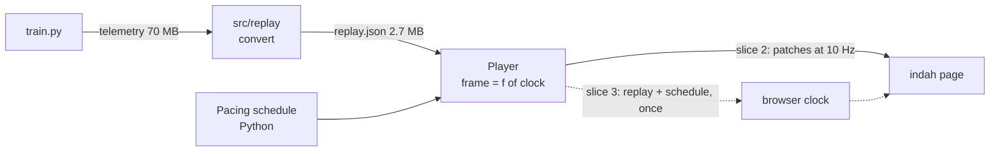

# Plan: browser dashboard for the Q-learning replay

Status: slices 1 and 2 done, slice 3 next. Supersedes the Pygame plan in `docs/archive/`.

## Goal

A single-screen (1920 x 1080, no scrolling) dashboard that replays a Q-learning run on Tower of
Hanoi from the first random episode to the first optimal 31-move solve, ready to screen-record for
YouTube. It shows the board, the explore/exploit decision, the full Q-table, and charts across and
within episodes, in dark and light themes (palette "Graphite and Citrus").

A second goal: find what [indah](https://github.com/leejianrong/indah) is missing for dashboards
like this and upstream it. Where indah falls short we say so here rather than work around it quietly.

## Decisions

| Decision | Why | ADR |
|----------|-----|-----|
| Build on indah in the browser, remove Pygame | Pygame crashed WSL; the layout outgrew hand-drawn UI | 0006 |
| Every frame is a pure function of one clock; the clock moves to the browser | Smooth 60 fps motion, scrubbing, deterministic video export | 0007 |
| Derive a compact columnar replay (2.7 MB) from telemetry (70 MB) | The Q-table is reproducible from the updates | 0008 |
| Board and pie live in this repo as indah bridge modules first, upstream later | Prove them before widening indah | 0006 |

### Server clock vs client clock

*Server clock:* Python decides what is on screen at every moment and sends each change over the
network. Simple, and every viewer is in sync, but motion is limited to a few updates a second,
every update crosses the network, and the video would depend on timing.

*Client clock:* the browser gets the whole replay once, then runs its own clock and draws each
frame itself. Python still decides the pacing (the timeline), the browser only follows it. Motion
is smooth, scrubbing is instant, and an exporter can advance the clock by hand, one frame at a
time. Slice 2 uses the server clock on purpose, to prove the layout; slice 3 swaps it.

## Shape

## Slices

| # | Slice | Status |
|---|-------|--------|
| 1 | Data layer: state ids, compact replay, Q-table rebuild, pacing schedule; Pygame removed | Done |
| 2 | Dashboard on today's indah with a server clock: layout, charts, heatmap, board and pie modules (no motion) | Done, layout unverified in a browser |
| 3 | Client clock and board animation: disc lifts above the rod, travels over, descends onto the stack (no arrow); scrubbing | Next |
| 4 | Indah features below, each as an indah ADR and card | |
| 5 | Deterministic clock, `?record` mode, frame capture and ffmpeg export | |
| 6 | Sound cues synced to the clock (ADR-0005), auto-pacing polish | |

## What indah lacks for this dashboard

Found while building slice 2; slice 4 upstreams the generic ones.

| Gap | Today | Needed |
|-----|-------|--------|
| G1 Fixed viewport | `Grid`/`Row`/`Column` flow and scroll | A `Frame` that fits one screen (1920 x 1080 scaled to the window), plus a record mode |
| G2 Chart kinds | Line, optional points | Bars, a playhead, shaded future region, dashed reference lines, a ghost series |
| G3 Heatmap | `magma`/`viridis`/`gray`; empty cells paint as the lowest colour | Masked cells, labels, current-cell highlight, custom diverging colours, cell aspect |
| G4 Pie | None | A pie with one lit slice |
| G5 Theming | Core roles plus `x-` extras, usable by modules only | Charts and canvases that read tokens, so the theme toggle recolours them |
| G6 Client clock | None | A browser-side playback clock with a manual mode for export |
| G7 Large data | Props go through patches | Fetch a static dataset once (typed arrays) |
| G8 Sound cues | `Audio` plays a file | Cues fired from clock events |

## Risks

- Layout is only checked through the app serving and tests, not in a browser: look at it before
  slice 3 builds on it.
- The Q update appears when a step is 75% done (`UPDATE_PHASE`); that choice is ours, change it freely.
- Headless Chromium for export may be heavy under WSL; fall back to a Windows screen recorder.
