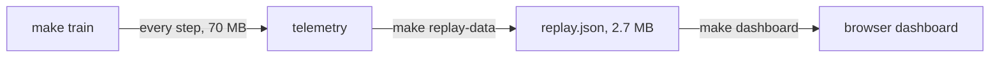

# Tower of Hanoi, learning to solve itself

Train a Q-learning agent on 5-disc Tower of Hanoi, then replay every episode in the browser: the
board, the explore-or-exploit decision, the whole Q-table and the learning curves on one screen,
paced to be watched and recorded.



The dashboard is a work in progress: the layout and data are in place, disc animation is next
(see [PLAN.md](PLAN.md)). A screenshot will go here once the layout has been checked in a browser.

## Quick start

Needs Python 3.11+ and [uv](https://docs.astral.sh/uv/).

```bash
uv sync                # install
make train             # about 30 s: trains, then writes records/replay.json
make dashboard         # prints a local URL; open it in a browser
```

Seed 7 reaches its first optimal 31-move solution at episode 655.

## Usage

Replay the run you just trained, or point the dashboard at another replay file:

```bash
uv run python -m src.dashboard records/replay.json
```

Train with other settings from Python:

```python
from train import train

train("records/small.json", num_discs=4, max_steps=100, max_episodes=500, seed=1)
```

Then convert it with `uv run python -m src.replay records/small.json records/replay.json`.

Play the game yourself in the terminal with `uv run python -m src.core.game`; moves are saved to
`records/`.

## Project layout

- `src/core`, `src/envs`, `src/agents`: the game, a Gymnasium environment and the Q-learning agent.
- `src/replay`: converts training telemetry into a compact replay and a watchable timeline.
- `src/dashboard`: the [indah](https://github.com/leejianrong/indah) app and its browser modules.
- `docs/adr`: architecture decisions. `PLAN.md`: where the project is going.

## Contributing

See [CONTRIBUTING.md](CONTRIBUTING.md). Run `make check` before pushing.

## License

No licence file yet, so all rights are reserved until one is added.
