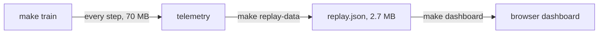

# Tower of Hanoi, learning to solve itself

Train a Q-learning agent on 5-disc Tower of Hanoi, then replay every episode in the browser: the
board, the explore-or-exploit decision, the whole Q-table and the learning curves on one screen,
built to be screen-recorded.




The board animates (a disc lifts over its rod, travels across and lands on the other stack), and
the charts and Q-table follow the clock. The whole dashboard fits one screen at any window size. It exports
to video frame by frame; see [PLAN.md](PLAN.md) for what is next.

## Quick start

Needs Python 3.11+ and [uv](https://docs.astral.sh/uv/).

```bash
uv sync                # install
make train             # about 20 s: trains, then writes records/replay.json
make dashboard         # prints a local URL; open it in a browser
```

Seed 7 reaches its first optimal 31-move solution at episode 655. Every step plays for 0.6 s, so
the whole run is about 14 hours at 1x: use the 64x button (about 13 minutes) or drag the slider.
Variable pacing for the video is planned (see [PLAN.md](PLAN.md)).

## Usage

Controls: space plays or pauses, the arrow keys step (with shift, jump an episode), the speed buttons
run 1x to 64x, and the slider scrubs. The dashboard is designed at 1920 x 1080 and scaled to fit any window
without scrolling; `uv run python -m src.dashboard --kiosk` covers the whole window for screen recording. `?t=120&paused=1` on the URL opens at 120 seconds, paused.

Export a video (needs ffmpeg; one-off setup `uv sync --group video` and
`uv run playwright install chromium`). It captures every frame, so it is exact but slow, about ten
minutes per minute of 60 fps video:

```bash
make video ARGS="--start 300 --end 330 --out records/clip.mp4"      # 30 s of the timeline
make video ARGS="--speed 64 --fps 30"                                # the whole run at 64x
```

Replay the run you just trained, or point the dashboard at another replay file:

```bash
uv run python -m src.dashboard records/replay.json
```

Train with other settings from Python:

```python
from train import train

train("records/small.json", num_discs=4, max_steps=100, max_episodes=500, seed=1)
```

Then convert it with `uv run python -m src.replay records/small.json records/replay.json`.

Play the game yourself in the terminal with `uv run python -m src.core.game`; moves are saved to
`records/`.

## Project layout

- `src/core`, `src/envs`, `src/agents`: the game, a Gymnasium environment and the Q-learning agent.
- `src/replay`: converts training telemetry into a compact replay and a watchable timeline.
- `src/dashboard`: the [indah](https://github.com/leejianrong/indah) app and its browser modules.
- `docs/adr`: architecture decisions. `PLAN.md`: where the project is going.

## Contributing

See [CONTRIBUTING.md](CONTRIBUTING.md). Run `make check` before pushing.

## License

Apache License 2.0, see [LICENSE](LICENSE).
